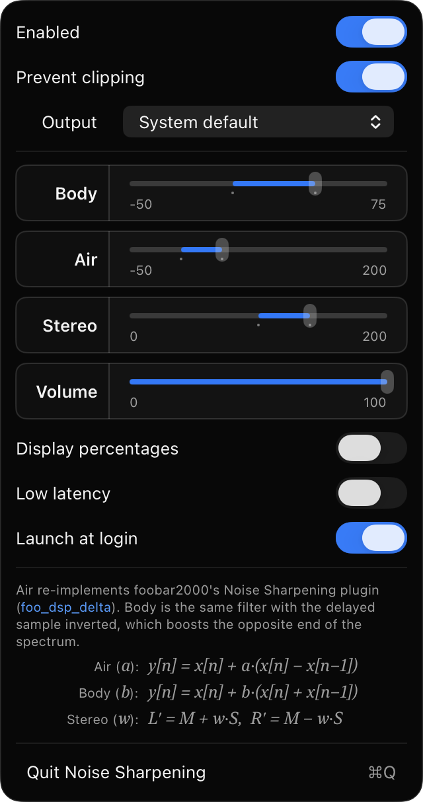

# Noise Sharpening for macOS

A menu-bar app that applies foobar2000's Noise Sharpening effect (foo_dsp_delta), and more, to all system audio on macOS. It reads the BlackHole 2ch loopback device, filters the audio and plays it to the output device you choose.

System-wide port of foobar2000's Noise Sharpening DSP (foo_dsp_delta). Per channel: `y = x + (x - x_prev) * strength`, with `strength = percent / 100`, range -50..200 %, default 40 %.

Two sliders: Air is the term above. Body adds the mirror-image low-frequency term, `y += bass * (x + x_prev)`: gain `1 + 2*bass` at DC and 1 at Nyquist, range -50..75 %, default 0 %. It is a gentle tilt (about +1.4*bass at fs/4), not a shelf with a chosen corner.

## Stereo

A third slider (Stereo) scales the stereo side signal: `M = (L + R)/2`, `S = (L - R)/2`, `L' = M + w*S`, `R' = M - w*S`. Range 0..200 %, default 100 % (unchanged); 0 % is mono; the slider also snaps at 140 %, a modest widening for laptop speakers. The mid signal is untouched, so a mono downmix is unchanged. Air and Body apply the same filter to both channels, so the order of the filter and the width stage does not change the result. Ignored for non-stereo audio.

## Prevent clipping

Off by default. When on, the output is scaled by `1 / (|1 + air + body| + |body - air|)` (never above 1, i.e. never a boost), the largest gain the processing can apply to a full-scale input (the filter's gain times `max(1, width)`). Output then stays within the input's peak level, at the cost of lowering overall level (for example -5.1 dB at Air 40 %). With it off, boosted peaks above full scale are clipped by the output device.

## Setup

1. `brew install blackhole-2ch`, then log out/in or reboot if the device does not appear.
2. Download `NoiseSharpening-<version>-universal.zip` (or `-apple-silicon` / `-intel` for a single architecture) from the [Releases page](https://github.com/ndoo/mac-noise-sharpening/releases) and move the app to Applications, or build it with `macos/build-app.sh` (Swift toolchain from Xcode or the Command Line Tools; output in `macos/build/NoiseSharpening.app`). Release builds are signed with a self-signed certificate and not notarized, so open them with right-click > Open the first time.
3. Open the app and allow microphone access (macOS gates all input capture behind that prompt) and Accessibility access (needed to intercept the volume keys).
4. In System Settings > Sound > Output, select "BlackHole 2ch". Pick the real output in the app's menu.

Local builds are signed with a "Noise Sharpening Local Signing" certificate from your keychain when present, which keeps the permission grants across rebuilds; otherwise they are ad-hoc signed and the grants reset on each build.

## Limits

- BlackHole is held at full volume. While it is the system output, the volume keys are intercepted and change the real output device's volume instead (the Volume slider in the menu shows that level). Without Accessibility access the keys do not reach the real device.
- Adds latency (roughly 20-40 ms with typical device buffers, more over Bluetooth); not suited to lip-sync-critical video unless delayed elsewhere. The Low latency switch (off by default) requests 128-frame buffers on BlackHole and the output device and keeps less audio queued, which can cut this to roughly 10-15 ms on wired or built-in outputs, at the risk of clicks on a busy system. The original buffer sizes are restored when the engine stops. These figures are estimates, not measurements.
- Stereo only. Clock drift between BlackHole and the output device is handled by dropping or zero-filling, which can click rarely.
- Release builds are signed with a self-signed certificate and not notarized.

## Tests

`cmake -S tests -B build && cmake --build build && build/test_core` covers the filter (impulse, DC and Nyquist gain, split buffers, reset, Prevent clipping, stereo width) and the ring buffer. `tests/detent_test.swift` covers the slider detent logic; compile it as a `main.swift` together with `macos/Sources/NSKit/DetentDrag.swift` using `swiftc`. XCTest and swift-testing are unavailable with Command Line Tools only, so there is no Swift test target.

## Release

Pushing a tag such as `v1.0.0` runs `.github/workflows/release.yml`, which runs the tests, builds the app and attaches universal, Apple silicon and Intel builds (`NoiseSharpening-v1.0.0-universal.zip`, `-apple-silicon.zip`, `-intel.zip`) to a GitHub release.

## License

MIT; see `LICENSE`.
